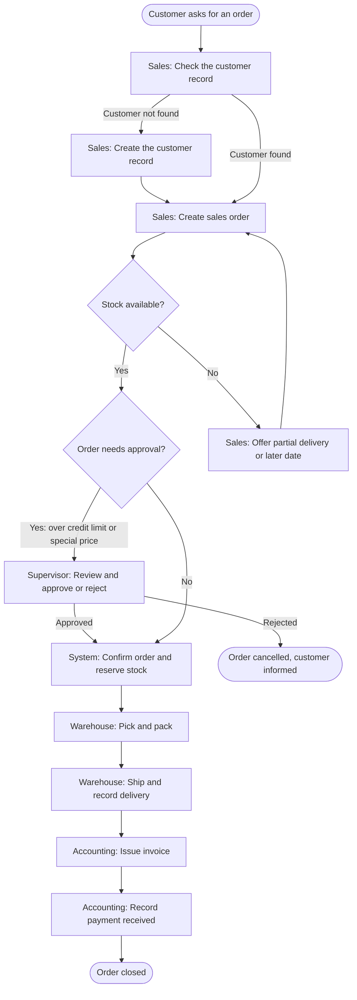

# Order-to-Cash Process Flow (To-Be)

**Company:** Sample Trading Co. (fictional)
**Purpose:** Describe how a customer order should move from request to payment once the ERP system is in use.
**Version:** 1.0 (draft for review)

## Roles

| Role | Short name | Responsibility |
| --- | --- | --- |
| Sales clerk | Sales | Takes orders and enters them in the system |
| Warehouse staff | Warehouse | Picks, packs, and ships orders |
| Accounting staff | Accounting | Issues invoices and records payments |
| Sales supervisor | Supervisor | Approves orders that need an exception |

## Flowchart

## Step descriptions

| Step | Owner | What happens | Output |
| --- | --- | --- | --- |
| 1. Check customer | Sales | Search the customer by name or code before creating anything new, to avoid duplicates. | Existing customer found, or a new one is needed |
| 2. Create customer | Sales | If not found, enter the required fields (name, address, contact number, payment terms). | New customer record |
| 3. Create sales order | Sales | Enter the items, quantities, and delivery date. The system fills in prices from the price list. | Draft sales order |
| 4. Check stock | System / Sales | The system shows available stock per item. If short, Sales offers a partial delivery or a later date. | Confirmed quantities |
| 5. Approval (only if needed) | Supervisor | Orders over the customer's credit limit, or with a price below the price list, need approval. | Approved or rejected order |
| 6. Confirm and reserve | System | The order is confirmed and stock is reserved so it cannot be sold twice. | Confirmed sales order |
| 7. Pick and pack | Warehouse | Warehouse receives a pick list, collects items, and packs them. | Packed order |
| 8. Ship | Warehouse | Record the delivery in the system. Stock is reduced. | Delivery record |
| 9. Invoice | Accounting | Create the invoice from the delivery record. | Invoice sent to customer |
| 10. Record payment | Accounting | Match the payment to the invoice. | Paid invoice, order closed |

## Business rules

1. A customer record must exist before an order can be created.
2. An order cannot be confirmed if any item has no price.
3. Orders above the customer's credit limit need Supervisor approval.
4. Stock is reduced when the delivery is recorded, not when the order is created.
5. An invoice can only be created from a recorded delivery.

## Open questions for the team

- Does the company allow partial deliveries for all customers, or only some?
- Who approves orders when the Supervisor is away?
- Should invoices be created per delivery or per order?
